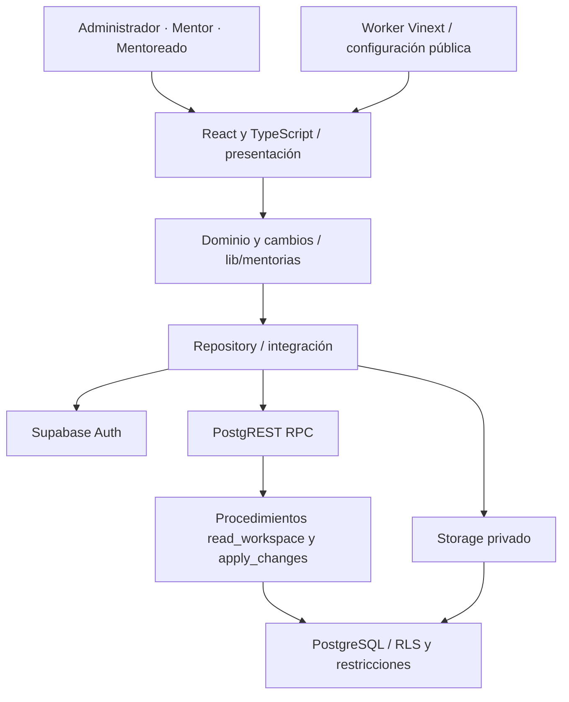

# Crea Empresa — gestión de mentorías

Aplicación académica con React y TypeScript, compilación Vite para Netlify y compatibilidad con la versión anterior Vinext/Sites. La interfaz conserva el diseño del proyecto y utiliza Supabase Auth, PostgreSQL y Storage cuando la conexión está configurada. La demostración funciona de forma separada en el navegador; cambiar su selector de rol no concede acceso a la base real.


## Netlify con Supabase

Sitio publicado: https://creaempresa-mentorias-inacap.netlify.app/

Proyecto Netlify: `06296a1c-3001-49fd-b5ac-ff6eeef3d0e8`. Primera publicación: `6afe6bce382d19521eca82a4`, 19 de noviembre de 2026.

El destino Netlify compila la misma interfaz React/TypeScript como una aplicación estática de Vite. Supabase sigue siendo el backend: Auth, PostgreSQL/RPC/RLS y Storage privado. No depende de un Worker de Cloudflare ni del acceso de ChatGPT. Los comandos originales de Vinext se conservan para la versión anterior en Sites.

```sh
npm ci
npm run dev:netlify
npm run build:netlify
npm run preview:netlify
```

Para desarrollo y build, copiar `.env.example` a `.env.local` y completar únicamente `SUPABASE_URL` y `SUPABASE_PUBLISHABLE_KEY`. También pueden definirse como variables del proceso o del entorno de build de Netlify. La compilación falla si faltan valores válidos. El servidor de desarrollo usa el puerto 3001 y la vista previa el 4173.

`netlify.toml` define `npm run build:netlify` y la carpeta `netlify-dist`. El build incluye `api/config.json`, `_redirects` y `_headers`, por lo que también se puede publicar la carpeta mediante Netlify Drop. `/api/config` devuelve solamente la URL y la clave publishable; son datos públicos por diseño. Las contraseñas, tokens de usuario y claves secretas no se incorporan al artefacto. Si cambia el proyecto Supabase hay que recompilar.

La sesión se valida directamente contra Supabase. La entrada web es pública, mientras los registros y archivos del programa conservan las políticas RLS y los permisos existentes. El acceso con correo y contraseña no utiliza una redirección OAuth. Si se incorporan recuperación de contraseña, magic links o OAuth, se deberán configurar sus URLs de retorno en Supabase.

La primera publicación se realiza mediante un artefacto verificado en Netlify Drop. No se habilita despliegue automático por cada push: se puede conectar posteriormente este repositorio con el comando, carpeta y variables anteriores.

## Ejecutar la versión anterior de Sites

Recomendado: Node.js 24 LTS y npm. En la carpeta del proyecto:

```sh
npm ci
npm run dev
```

Abrir la URL que imprime Vite. Sin configuración cloud se muestra la opción de demostración, sin simular una cuenta autenticada.

## Activar Supabase

1. Utilizar un proyecto nuevo o verificar que no contiene las tablas de esta aplicación. No aplicar la migración en otra aplicación existente.
2. Ejecutar `supabase/migrations/202611180001_mentorias.sql` en SQL Editor. Es una transacción. El modelo de `evaluacion2/implementacion` es histórico: **no ejecutar ambos modelos**.
3. Crear el usuario administrador en Authentication y asociar su UID mediante `supabase/primer-administrador.sql`, reemplazando el marcador. Las contraseñas se definen en Supabase, nunca en el repositorio.
4. Copiar `.env.example` a `.dev.vars` para el Worker local y completar la URL y la clave **publishable** del proyecto. Reiniciar Vite. En hosting, configurar esas mismas variables de runtime. Nunca usar una clave secreta ni `service_role` como clave pública.
5. Verificar que `/api/config` devuelve `configured: true`. Iniciar sesión, crear personas y guardar; después crear una mentoría. Al guardarla, PostgreSQL crea sus seis sesiones.
6. Vincular las cuentas de mentores y participantes con sus fichas usando los ejemplos comentados del script. No se permite que un usuario cambie su propio rol.

Los cambios se guardan mediante el botón **Guardar cambios**. Un lote inválido se revierte completo. Si otra persona modificó el mismo registro, se rechaza el guardado y se solicita actualizar. Para adjuntar archivos a una ficha nueva, guardarla primero. Las fotos aceptan PNG/JPEG de hasta 2 MB y los documentos PDF de hasta 5 MB. Los enlaces privados duran 15 minutos; **Actualizar** renueva su acceso.

## Arquitectura y seguridad

- Presentación: `app/page.tsx`, componentes de interfaz y `components/mentorias-access.tsx`.
- Dominio y operaciones: `lib/mentorias/domain.ts`, `access.ts` y `changes.ts`.
- Infraestructura: `lib/mentorias/repository.ts` adapta Auth, RPC y Storage.
- Base de datos: migración SQL con relaciones, restricciones, RLS, auditoría y control de versiones.

El backend efectivo es Supabase: se conserva la separación por capas, pero no se presenta el demostrador Node/SQLite como servidor de la web. Si el informe anterior menciona Express, hay que actualizar esa decisión y justificar el uso de funciones PostgreSQL y servicios administrados.

`get_workspace()` extrae los registros aplicando RLS y se usa también antes de exportar. `save_changes()` valida y guarda cada lote en una transacción. `dashboard_summary()` permite extraer indicadores desde SQL. Las funciones RPC delegan en los procedimientos `read_workspace(INOUT result jsonb)` y `apply_changes(commands jsonb)` mediante `CALL`. Así se ejecutan procedimientos reales de PostgreSQL tanto para extraer como para guardar información; las funciones sirven de adaptador para PostgREST.

Las sesiones de Auth permanecen solo en memoria del navegador. Recargar exige iniciar sesión nuevamente. Las escrituras se limitan a 120 lotes por minuto por cuenta. En Supabase Auth se configuraron y guardaron 10 solicitudes de registro/inicio de sesión cada 5 minutos por IP. Los tokens de acceso duran 3600 segundos; la detección de reutilización de refresh tokens está activa, con intervalo de 10 segundos. Se verificó que la sesión única, el tiempo máximo y el cierre por inactividad están restringidos al plan Pro: siguen pendientes y no se simulan como controles de seguridad del servidor. La renovación automática de tokens significa que 3600 segundos NO es la duración máxima de una sesión.

Las evidencias permanecen en un bucket privado, con rutas autorizadas por usuario y sin sobrescrituras. Se valida firma de archivo en cliente y tamaño/MIME en Storage y SQL. Esto **no equivale a un análisis antivirus en servidor**. Los archivos cargados pero no guardados, o reemplazados, requieren una política posterior de limpieza; no se borran automáticamente documentos del programa.

## Verificación

```sh
npm run typecheck
npm test
npm run build
npm run lint
```

Las pruebas incluyen el demostrador anterior, controles del cliente y la migración ejecutada en PostgreSQL local con PGlite. Las tablas Auth/Storage se simulan en esa prueba para comprobar RLS y rutinas; no reemplaza verificar login, subida y exportación contra Supabase real. No se insertan participantes reales ni se envían invitaciones automáticamente.

## Entorno observado

Equipo de desarrollo: Windows 11 Home Single Language 10.0.26200, Intel Core 5 210H, 12 procesadores lógicos y 7,6 GB de RAM utilizable. Estos datos describen el equipo inspeccionado; no implican que se haya instalado hardware nuevo. Proyecto cloud verificado: **Crea Empresa - Mentorias**, referencia `semwbguhguuoazomgcez`, organización con plan gratuito, cómputo Nano y región West US (Oregon), `us-west-2`. Supabase administra el hardware. Se observó el estado Healthy y se aplicó el script desde SQL Editor; no se ha registrado una ejecución con Supabase CLI.

La entrega debe acompañarse de evidencia del sistema conectado y una demostración con administrador, mentor y mentoreado. El código y las pruebas locales no acreditan por sí solos un despliegue cloud.

## Estado verificado de esta implementación

- Migración aplicada al proyecto nuevo: ocho tablas con RLS y bucket privado. El proyecto anterior Notes no fue modificado.
- Conexión local configurada en `.dev.vars`, excluido de Git; `/api/config` responde `configured: true`.
- API cloud: lectura anónima de mentores y ejecución anónima de `get_workspace` rechazadas con HTTP 401 / SQLSTATE 42501.
- Pruebas locales: 32 aprobadas, incluyendo las 18 del demostrador anterior. TypeScript y lint pasan.
- Exportación probada desde la interfaz: cinco hojas con logo y únicamente los datos del mentor seleccionado.
- Cuenta inicial creada por el usuario y vinculada como Administrador. Se verificaron login/logout, creación de personas y mentorías, seis sesiones por mentoría, guardado, recarga, foto PNG, foto de perfil, PDF privado y exportación Excel contra Supabase real.
- Pruebas de rol: se usó temporalmente la misma cuenta como Mentor y Mentoreado. El mentor guardó su sesión y su Excel excluyó el conjunto ajeno; el mentoreado no tuvo edición de sesiones ni exportación. Al terminar se restauró Administrador.
- Permanecen dos conjuntos identificados como PRUEBA QA, sin participantes reales, para reproducir la demostración.
- Correcciones detectadas en navegador: botón Ingresar con type=submit, descarte de vistas autenticadas cuando no hay sesión, errores de validación comprensibles, bloqueo de acceso a demostración durante login y fecha automática en America/Santiago.
- Actualización del 19 de noviembre: nueva versión publicada correctamente en Sites con las variables públicas de Supabase configuradas. La audiencia sigue siendo privada. La sesión del navegador integrado solicitó autenticación de ChatGPT, por lo que el flujo autenticado del hosting no se volvió a comprobar desde ese navegador.

El lint conserva las comprobaciones de accesibilidad. En los componentes base reutilizables se exceptúa únicamente la preferencia estilística de etiqueta nativa sobre un rol ARIA válido, para conservar su contrato de composición.


## Decisión de arquitectura para EVA3

La solución utiliza cliente-servidor y separación por capas. React/TypeScript presenta la interfaz; dominio y cambios preparan las operaciones; MentoriasRepository conecta con Supabase Auth, PostgreSQL y Storage. Vinext/Vite genera el frontend y el Worker que entrega la configuración pública. La autorización efectiva reside en PostgreSQL/RLS y Storage. Se sustituye la propuesta anterior de un servidor Express por servicios administrados para reducir la instalación y mantener autenticación, datos y archivos en el mismo proveedor. El ejemplo SQLite anterior se conserva como antecedente académico, no como backend de esta web.



El modelo relaciona mentors y mentees con mentorships; cada mentoría tiene seis sessions y cada sesión admite una evidence por tipo (foto/documento). app_profiles vincula la identidad de Auth y su rol. audit_events y write_limits soportan auditoría y control de escrituras. Las claves foráneas evitan referencias inexistentes; la unicidad evita repetir sesiones y tipos de evidencia. Los archivos binarios se guardan en Storage y sus metadatos en PostgreSQL. Las especialidades del mentor usan text[] como colección de etiquetas; no se declara una normalización estricta a primera forma normal de ese atributo. Si se necesita un catálogo compartido de especialidades, deberá separarse en tablas de catálogo y asociación.

## Entrega y demostración

Las capturas de `evidencias/` documentan la interfaz y los ajustes observados. El documento de EVA3 describe la implementación actual y sus límites; no modifica el informe de otra asignatura. La demostración puede seguir este recorrido: iniciar sesión, revisar el resumen, abrir una ficha, abrir una mentoría, desplegar una sesión, registrar su resumen y guardar; finalmente elegir las hojas y exportar Excel. Los datos PRUEBA QA son ficticios y deben identificarse como tales.

El entorno local usa HTTP en localhost:3000; Supabase usa HTTPS/443. El equipo cliente ejecuta el navegador y el entorno de desarrollo, mientras Supabase administra cómputo y almacenamiento. La instalación local se reproduce con Node 24, npm ci, las variables públicas y npm run dev. La publicación del frontend requiere además configurar las variables en el hosting; nunca se incluyen contraseñas ni claves service_role.

### Límites conocidos

- Sesión única, duración máxima e inactividad del servidor: no disponibles en el plan gratuito observado. No se contrató Pro.
- El control de carga de archivos no incluye antivirus; falta automatizar la limpieza de objetos huérfanos.
- La creación y vinculación de cuentas se realiza desde Supabase, no desde un módulo de invitaciones de la web.
- No se han acreditado pruebas de carga, restauración de respaldos ni auditoría integral de accesibilidad.
- La publicación conserva la audiencia privada del sitio. Un enlace publicado no otorga por sí solo acceso al docente.


## Verificación de la actualización visual

Revisión del 19 de noviembre de 2026: npm ci instaló 660 paquetes en una copia limpia del código y npm run build terminó correctamente sin variables privadas. Esto verifica instalación y compilación; la conexión de una instalación nueva requiere configurar sus variables públicas. En el proyecto principal pasaron typecheck y lint; las 32 pruebas volvieron a aprobarse (18 corresponden al demostrador histórico). El build advierte un fragmento mayor de 500 kB, por lo que no se acredita una optimización completa de rendimiento.

En navegador se comprobó el inicio de sesión real, apertura de fichas, despliegue individual de sesiones y guardado de un resumen ficticio; la interfaz confirmó «Cambios guardados en el programa». En escritorio no se observó desbordamiento horizontal (1226 px de contenido y viewport). El intento de emulación móvil no modificó el tamaño real del navegador; la verificación móvil queda pendiente y no se considera aprobada por las reglas responsive del CSS.


## Publicación actual

Publicación confirmada por Sites el 19 de noviembre de 2026: https://monitoreo-mentorias-2026-inacap.zaxht.chatgpt.site (privada). Fuente de la versión publicada: b510cdf6acba44d483b7975631f87ab154e61d3d. Variables SUPABASE_URL y SUPABASE_PUBLISHABLE_KEY configuradas en el hosting. Repositorio privado: https://github.com/Zaxht/creaempresa-mentorias-inacap. El servidor de desarrollo permanece en http://localhost:3000.

El informe técnico breve está en evidencias/Informe_EVA3.html y el registro de comprobaciones en evidencias/VERIFICACION.txt. El HTML es un complemento de implementación; no reemplaza ni modifica el Word anterior de otra asignatura. La vista del informe HTML no se pudo abrir en el navegador integrado porque este bloquea URLs file://; sus capturas se revisaron por separado.


### Comprobación del despliegue Netlify

La portada y /api/config devolvieron HTTP 200 desde el dominio definitivo. La configuración identifica el mismo proyecto Supabase y una clave publishable. Se comprobaron las cabeceras nosniff, DENY y no-store en la configuración. La compilación se probó localmente con inicio de sesión y carga del dashboard real. Typecheck, lint y las 32 pruebas automatizadas aprobaron. El paquete subido contiene únicamente los archivos estáticos de netlify-dist, sin archivos de entorno.


Desde el dominio Netlify definitivo se verificaron también el inicio de sesión del administrador, la carga de las dos mentorías de prueba y la descarga de Excel. El archivo exportado contiene las cinco hojas, el logo y los datos ficticios existentes de Supabase. Se corrigió el ajuste de etiquetas largas en las tarjetas del resumen.
